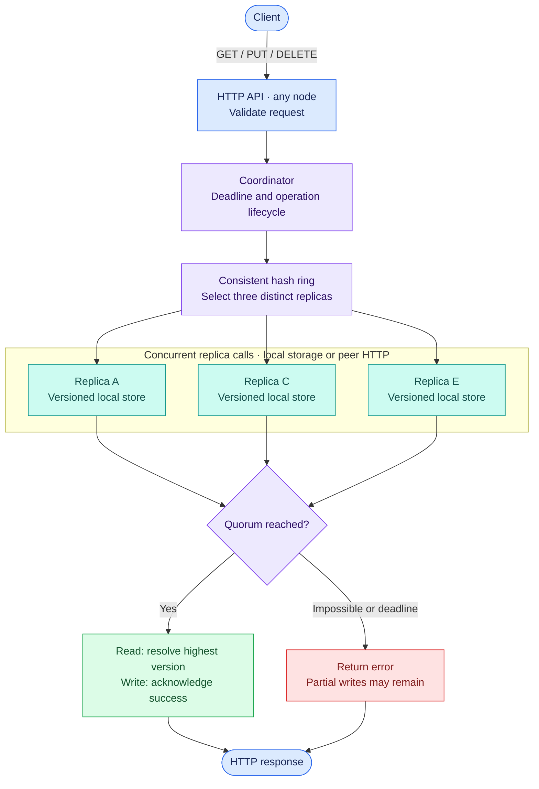

# kvstore

A distributed key-value store built with Go's standard library. It implements
consistent hashing, quorum replication, versioned records, append-only
persistence, Prometheus metrics, and concurrent HTTP benchmarking.

The default cluster runs five nodes with three replicas per key and read/write
quorums of two. Any node can coordinate requests.

## Pipeline



**GET** collects a read quorum and returns the highest observed version.
**PUT/DELETE** first reads a quorum, reserves a higher version, then sends the
same record to all replicas and waits for a write quorum. Remaining writes
continue until the original deadline. Replica labels above are illustrative;
owners depend on the key.

For persistent replicas, mutations follow **append log → sync disk → publish in
memory → acknowledge**. Reads use the published in-memory state.

## Distributed systems concepts

- **Partitioning and consistent hashing:** SHA-256 ring positions, virtual nodes,
  and clockwise selection distribute keys across distinct physical owners.
  Static membership gives every node the same placement rules.
- **Replication and quorums:** `N=3`, `R=2`, `W=2` tolerate one unavailable replica.
  `R + W > N` ensures read/write quorum overlap within the same replica set;
  overlap alone does not establish linearizability.
- **Logical versioning and conflict resolution:** counters order updates, with
  originating node IDs breaking ties. Replicas reject stale records and accept
  identical duplicates. Versions do not represent wall-clock time.
- **Tombstones:** versioned deletion markers preserve deletion history and
  prevent older values from overwriting an observed deletion.
- **Partial failures and bounded work:** concurrent requests use deadlines and
  cancellation. Failed writes may have effects; there is no rollback. Retrying
  a public write creates a new version.
- **Persistence and recovery:** append-only logs, disk synchronization, checksums,
  and startup replay restore local records and counters. Incomplete final log
  entries are discarded; restart does not repair updates missed while offline.
- **Observability and measurement:** Prometheus counters and latency histograms,
  failure experiments, and workload-specific throughput and percentile reports.

## Go concepts

- **Structs, receivers, and composition** model records, stores, and coordinators;
  small, implicitly satisfied interfaces separate storage, transport, and APIs.
- **Pointers, value semantics, and visibility** distinguish shared mutable stores
  from record copies; capitalization controls package exports.
- **Maps, slices, and struct tags** provide indexed storage, ordered ring points,
  set membership via `map[string]struct{}`, and JSON representations.
- **Goroutines, buffered channels, and `sync.WaitGroup`** execute and collect
  replica calls concurrently. Generics share quorum logic between reads and writes.
- **`sync.RWMutex`** protects local shared state and related updates while allowing
  concurrent readers. Local locks do not coordinate separate nodes.
- **`context.Context`, `defer`, and explicit errors** propagate cancellation and
  deadlines, release resources, and preserve error causes through wrapping.
- **Unit tests, integration tests, and race detection** exercise component
  behavior, network failures, concurrent access, and crash recovery.

## Run it

Requires Go 1.27+. Persistent storage supports macOS and Linux.

```bash
go run ./cmd/node -data-dir data/standalone
```

In another terminal:

```bash
curl -i -X PUT http://127.0.0.1:8001/kv/user:42 \
  -H 'Content-Type: application/json' -d '{"value":"Alice"}'
curl -i http://127.0.0.1:8001/kv/user:42
curl -i -X DELETE http://127.0.0.1:8001/kv/user:42
```

PUT and DELETE return `204`; GET returns a JSON key/value or `404` when absent.
Restart with the same directory to recover data. Omit `-data-dir` for memory-only
storage.

For the five-node cluster, install Docker Engine and Compose, then run:

```bash
docker compose up --build -d --wait
```

Nodes are available on ports 8001–8005, each with a persistent volume.
`docker compose stop node-c` demonstrates a replica outage; restart it with
`docker compose up -d --wait node-c`. Send requests to a running node.
`docker compose down` retains data; adding `--volumes` deletes it.

`GET /health` reports process liveness; `GET /metrics` exposes request counts,
latency histograms, replica failures, and quorum failures. Liveness does not
mean a quorum is available.

## Read the code

| Order | Files | Focus |
| --- | --- | --- |
| 1 | [record.go](internal/storage/record.go), [memory.go](internal/storage/memory.go) | Versions, tombstones, and synchronized local state |
| 2 | [ring.go](internal/consistenthash/ring.go), [membership.go](internal/cluster/membership.go), [config.go](internal/config/config.go) | Placement, node identities, and configuration |
| 3 | [local.go](internal/routing/local.go), [handler.go](internal/api/handler.go), [replica.go](internal/api/replica.go), [http.go](internal/transport/http.go) | Local operations, public API, and peer communication |
| 4 | [quorum.go](internal/replication/quorum.go), [coordinator.go](internal/replication/coordinator.go), [lifecycle.go](internal/replication/lifecycle.go) | Concurrent replication, quorum decisions, and cancellation |
| 5 | [persistent.go](internal/storage/persistent.go), [main.go](cmd/node/main.go) | Persistence and application wiring |

## Validate and measure

```bash
go vet ./...
go test -race ./...
go run ./cmd/bench -nodes http://127.0.0.1:8001 \
  -requests 5000 -concurrency 20 -read-percent 50 -keys 1000 -value-bytes 256
```

The benchmark preloads read keys, writes distinct keys, and reports throughput,
error rate, and p50/p95/p99 latency. Generated keys remain in storage. Its fixed
concurrency can underrepresent overload latency because workers wait for replies
before sending more requests.

[Recorded five-node benchmarks](docs/benchmarks/local-2026-10-08.md) include the
workload, hardware, failure experiment, and raw results.

## Current limits

Membership is static: configuration changes do not migrate data. There is no
consensus, linearizability guarantee, automatic replica repair, or guaranteed
convergence after an outage. Logs have no compaction, and tombstones are retained.
Memory-only restarts lose records and counters. Internal endpoints assume a
trusted environment; authentication and TLS termination are outside this project.
